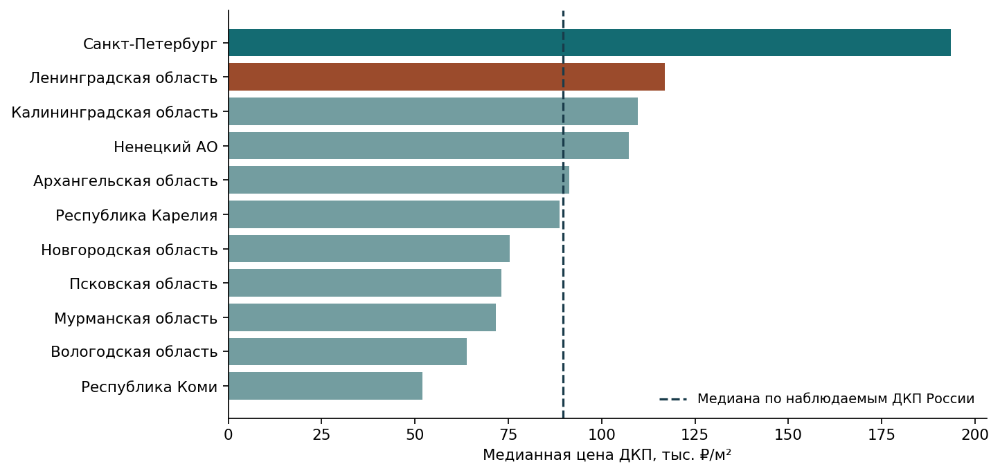
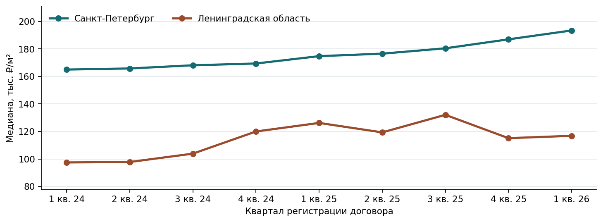
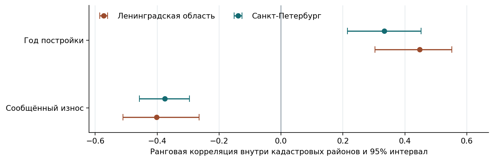
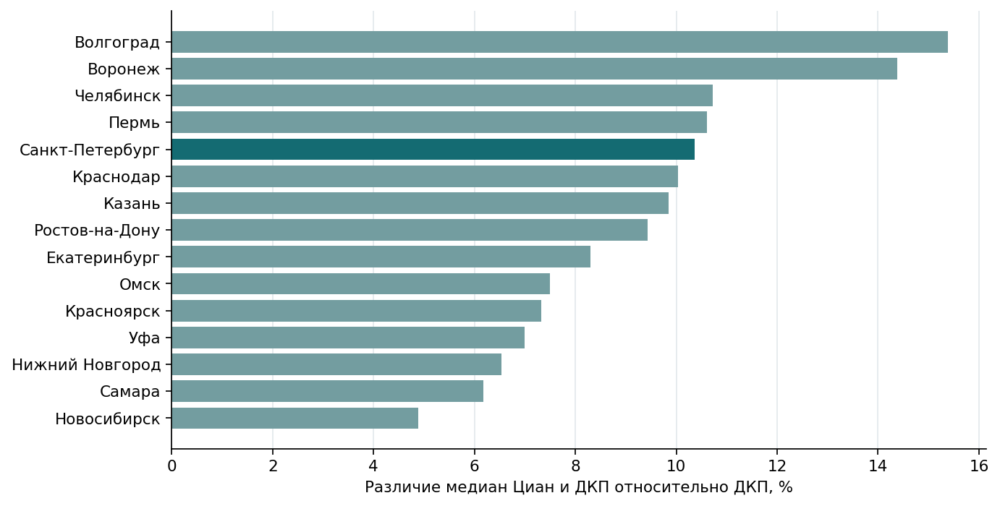

# Анализ цен сделок с жильём в России с фокусом на Санкт-Петербург и Ленинградскую область

Жилинко Злата, Бусламов Анис, Соловьев Кирилл · группа 60202 · 2026/2027 учебный год

## Аннотация

Мы подготовили воспроизводимую систему обработки 2,19 ГБ открытых данных о российской недвижимости. Использовали зарегистрированные договоры, сведения о домах из ГИС ЖКХ и географические агрегаты предложений Циан. Для каждого источника учли единицу наблюдения и период. Получили региональные и городские сравнения, оценили динамику на сопоставимых группах, чувствительность результатов к очистке и связь цен с характеристиками жилфонда. В Петербурге медианное изменение по сопоставимым группам составило +11,5% к I кварталу 2026 года. В Ленобласти вывод о динамике всей области ограничен покрытием. Сравнение двух ценовых сигналов расширено на 15 городов России.

## Цель и задачи исследования

Цель работы — исследовать пространственные различия и динамику цен сделок с жильём, учитывая качество данных и состав наблюдений. Цена в зарегистрированном договоре и цена предложения характеризуют разные этапы рынка. Сопоставление источников позволяет проверить устойчивость выводов к способу измерения.

1. Исследовать пространственные различия цен сделок с жильём в регионах России и городах Северо-Запада, выделив территории с наиболее высоким и низким уровнем цен.

2. Проанализировать динамику цен в Санкт-Петербурге и Ленинградской области с учётом изменений состава выборки и оценкой устойчивости результатов.

3. Оценить качество и полноту исходных данных, выявить некорректные и аномальные записи и исследовать влияние правил очистки на ценовые показатели.

4. Исследовать взаимосвязь цен сделок с возрастом и износом жилфонда на уровне кадастровых кварталов.

5. Сопоставить цены предложений и зарегистрированных сделок в городах России, оценив различия между источниками и их изменение во времени с акцентом на Санкт-Петербург.

Росстат использует фактические сделки и сопоставимые типы квартир при расчёте индексов жилья. КвартаЛаб рассчитывает медианы на выгрузках Росреестра и описывает ограничения сгруппированных договоров. Циан публикует географические агрегаты предложений. В работе использованы собственные процедуры проверки, территориального объединения, сравнения состава выборок и оценки неопределённости. [Методология Росстата](https://rosstat.gov.ru/storage/mediabank/SSRD_met_IZ_RJ.pdf) · [Методика КвартаЛаб](https://kvartalab.ru/ceny/metodika) · [Описание геокластеров Циан](https://huggingface.co/datasets/cianml/ru-real-estate-geo-temporal-clusters)

## Источники и модель данных

| Источник | Единица исходных данных и период | Записи | Байт |
|---|---|---|---|
| Сборка выгрузок Росреестра | Строка с одним или несколькими договорами, I кв. 2024 — I кв. 2026 | 6 756 046 | 1 330 536 491 |
| ГИС ЖКХ в обработке «Если быть точным» | Запись о доме, срез августа 2026 года | 956 147 | 584 316 632 |
| Циан | Геокластер, период и категория, 2024–2025 годы | 456 182 | 278 191 340 |
| Итого | Три исходных CSV | 8 168 375 | 2 193 044 463 |

Исходные данные скачаны готовыми открытыми выгрузками. Сборка Кирилла Мурашева нормализует региональные таблицы в CSV. Прямой запрос к каталогу Росреестра в нашей среде вернул HTTP 403, поэтому использована эта сборка с проверкой опубликованного SHA-256. Побайтовая сверка с оригиналами Росреестра остаётся ограничением происхождения. ГИС ЖКХ и сделки охватывают регионы России, Циан — 16 городов. Объём 2,19 ГБ относится к полным файлам до очистки. [Сборка сделок](https://huggingface.co/datasets/Cyrill-Murashev/real-property-transactions-russia-2024-2026) · [Жилфонд](https://tochno.st/datasets/gisgkh)

У строки сделки есть тип объекта, назначение, тип договора, цена, площадь и квартал регистрации. Кадастровый квартал задаёт территорию. У дома известен кадастровый номер, из которого выделяется этот территориальный ключ. Множество договоров и множество домов сначала агрегируются отдельно, затем соединяются по кадастровому кварталу. Циан и ДКП сопоставляются на уровне города и календарного года.

| Сущность | Ключ агрегации или связи | Основные признаки |
|---|---|---|
| Наблюдение договора | Регион, дата, кадастровый квартал | Цена, площадь, тип договора, число договоров в строке, город |
| Дом ГИС ЖКХ | Идентификатор дома, кадастровый квартал | Год постройки, износ, состояние |
| Территориальная витрина | Регион и кадастровый квартал | Медиана цены, число ДКП, характеристики местного жилфонда |
| Городская витрина источников | Город и календарный год | Цена ДКП, медиана геокластеров Циан, покрытие и относительное различие |

## Реализация и общие правила отбора

Скрипт загрузки фиксирует версии, длину и SHA-256 файлов. Spark читает кавычки и переносы строк внутри полей, приводит типы, проверяет даты и записывает аудит. Независимое чтение CSV подтвердило количество записей. В основной выборке остаются рублёвые ДКП жилых помещений с одним договором в строке. Площадь ограничена 10–400 м², удельная цена — 5 000–2 000 000 ₽/м². Цена за м² равна цене договора, делённой на площадь.

Названия городов приведены к нижнему регистру, повторные пробелы удалены, «ё» приведена к «е», префиксы «город» и «г.» удалены. Для городских сравнений ключ включает регион, кадастровый район и нормализованное имя, чтобы различия текстового поля административного района не дробили одну территорию, а одноимённые населённые пункты разных районов сохранялись отдельно.

Подготовленные ДКП сохранены в 24 файлах Parquet. Сводки записываются в JSON, из них формируются графики и локальная HTML-страница. Для региональных и городских цен публикуются число наблюдений, медиана и 25-й и 75-й процентили при наличии хотя бы 30 наблюдений. Используется приближённый алгоритм процентилей Spark. Порог 30 — принятое правило публикации, а полнота рыночного охвата проверяется отдельно.

## Результаты задачи 1 Пространственные различия

В I квартале 2026 года общая медиана по 212 037 наблюдаемым ДКП России составила 89 695 ₽/м². Она рассчитана по записям, а региональные медианы используются для описания территорий. В региональной витрине этого квартала достаточно наблюдений для 87 кодов регионов.

| Территория | Медиана, ₽/м² | Наблюдения | К медиане России, % |
| --- | --- | --- | --- |
| Санкт-Петербург | 193 407 | 10 788 | +115,6 |
| Ленинградская область | 116 848 | 4 082 | +30,3 |
| Калининградская область | 109 661 | 2 177 | +22,3 |
| Ненецкий АО | 107 303 | 82 | +19,6 |
| Архангельская область | 91 241 | 2 431 | +1,7 |
| Республика Карелия | 88 704 | 1 265 | −1,1 |
| Новгородская область | 75 388 | 1 227 | −15,9 |
| Псковская область | 73 198 | 707 | −18,4 |
| Мурманская область | 71 569 | 1 713 | −20,2 |
| Вологодская область | 63 776 | 33 | −28,9 |
| Республика Коми | 51 896 | 1 748 | −42,1 |

Среди наблюдаемых регионов Северо-Запада наибольшая медиана у Петербурга, затем у Ленобласти и Калининградской области. Минимальная — у Республики Коми. Вологодская область представлена 33 наблюдениями, поэтому её значение особенно чувствительно к составу выгрузки. Относительные различия показывают структуру доступных договоров. На них влияют типы жилья, размеры населённых пунктов и полнота регистрации признаков.

| Город | Медиана, ₽/м² | 25–75 процентили | Наблюдения |
| --- | --- | --- | --- |
| Кудрово | 202 861 | 189 300–215 129 | 248 |
| Мурино | 184 825 | 164 980–200 000 | 536 |
| Всеволожск | 130 137 | 112 040–146 707 | 174 |
| Город Калининград | 119 681 | 95 297–147 000 | 1 278 |
| Архангельск | 97 720 | 72 072–119 565 | 916 |
| Петрозаводск | 103 896 | 85 339–125 000 | 695 |
| Великий Новгород | 96 491 | 77 381–118 395 | 709 |
| Мурманск | 97 693 | 77 083–114 504 | 743 |

Внутри Всеволожского района Кудрово и Мурино дороже Всеволожска. Среди выбранных городов Северо-Запада Калининград, Петрозаводск, Архангельск, Великий Новгород и Мурманск дают дополнительный масштаб сравнения. После объединения вариантов написания городов итоговая витрина содержит 718 групп за девять кварталов. Данные остальных регионов России используются также в общей медиане, аудите и проверке распределённой обработки.

## Результаты задачи 2 Динамика и состав выборки

Для годового сравнения фиксируем кадастровый район и диапазон площади. В Ленобласти дополнительно фиксируем населённый пункт. Диапазоны — от 10 до менее 40 м², от 40 до менее 65 м² и от 65 до 400 м². Сравниваем одинаковый календарный квартал соседних лет. В группе должно быть хотя бы 10 записей в обоих периодах.

Изменение группы равно (медиана нового периода / медиана предыдущего периода − 1) × 100%. Итог — медиана изменений групп с одинаковыми весами. Кадастровый квартал описывает территорию, а календарный квартал описывает время.

| Регион | Общая медиана, год к году | Сопоставимые группы | Охват I кв. 2025 и I кв. 2026 |
|---|---|---|---|
| Санкт-Петербург | +10,7% | +11,5%, 48 групп в 16 кадастровых районах | 99,79% и 99,78% |
| Ленинградская область | −7,4% | +8,3%, 6 групп в одном кадастровом районе | 33,19% и 21,39% |

Неопределённость оценена 2 000 повторными выборками целых кадастровых районов. Интервал задают 2,5-й и 97,5-й процентили повторных результатов. Для Петербурга это +10,6…+12,4%. При изменении порога группы на 5 и 20 наблюдений оценки остаются около +11,4…+11,5%.

В Ленобласти общая выборка выросла с 479 до 4 082 наблюдений. Изменение долей районов составило 21,2 п. п. по половине суммы абсолютных различий долей, в Петербурге — 4,2 п. п. При порогах 5, 10 и 20 область даёт +13,0%, +8,3% и +16,3% на разных подвыборках. На базовом пороге представлен один кадастровый район, поэтому региональный вывод ограничен охватом. Этот интервал публикуется при наличии хотя бы пяти районов и характеризует наблюдаемую выборку, включая её территориальную зависимость.

## Результаты задачи 3 Качество и чувствительность к очистке

В исходнике 946 622 строки объединяют несколько договоров. У 14 записей не разобралась дата. Среди 2 239 105 строк ДКП жилых помещений 1 993 372 содержат один договор. После проверки валюты, площади, цены, даты и региона осталось 1 952 424 наблюдения. Петербург представлен 97 962 наблюдениями, Ленобласть — 21 025.

Для проверки чувствительности рассчитали три сценария. Базовый оставляет 10–400 м² и 5–2 000 тыс. ₽/м². Средний — 20–200 м² и 20–1 000 тыс. ₽/м². Узкий — 25–150 м² и 30–600 тыс. ₽/м². Остальные условия одинаковы. Эти диапазоны являются исследовательскими настройками. Сужение диапазона меняет состав жилья и позволяет оценить устойчивость ценового уровня.

| Сценарий | Санкт-Петербург | Ленинградская область |
| --- | --- | --- |
| Базовый | 193 407 ₽/м²; n = 10 788 | 116 848 ₽/м²; n = 4 082 |
| Средний | 196 809 ₽/м²; n = 10 152 | 120 000 ₽/м²; n = 3 895 |
| Узкий | 196 721 ₽/м²; n = 9 266 | 114 865 ₽/м²; n = 3 416 |

В Петербурге медианы I квартала 2026 года лежат в диапазоне 193,4–196,8 тыс. ₽/м². В Ленобласти — 114,9–120,0 тыс. ₽/м². Ценовой порядок двух регионов сохраняется при всех сценариях, но количество наблюдений и точечная оценка меняются.

Внутри базовой выборки дополнительно помечены цены за границами Q1 − 1,5 IQR и Q3 + 1,5 IQR для соответствующих региона и календарного квартала. В I квартале 2026 года таких наблюдений 509 из 10 788 (4,72%) в Петербурге и 1 из 4 082 (0,02%) в Ленобласти. Флаг обозначает необычную цену относительно своей группы. Для установления ошибки или особых условий договора нужна проверка первичной записи.

Аудит также считает пропуски и неположительные цены и площади, другие валюты и расхождения кода региона с префиксом кадастрового квартала. Эти показатели могут пересекаться. С II квартала 2025 года по I квартал 2026 года отбор прошли 56 ДДУ в Ленобласти и 25 в Петербурге, при этом ни один квартал не достиг 30 наблюдений. ДДУ используется для оценки покрытия источника в этом разрезе.

## Результаты задачи 4 Жилфонд и цена

Сопоставились 412 из 413 ценовых кадастровых кварталов Ленобласти и 1 360 из 1 362 в Петербурге. На стороне цен требуется не менее десяти наблюдений за весь период. На стороне жилфонда дома дедуплицированы по идентификатору ГИС ЖКХ. Износ ограничен 0–100%, год постройки — 1700–2026.

Внутри кадастровых районов ранжируем территории по цене и по характеристике жилфонда, стандартизируем ранги и рассчитываем корреляцию по объединённым кварталам. При бутстрэпе пересэмплируем целые районы. В Ленобласти связь с годом постройки составляет 0,45 с 95% интервалом 0,30…0,55, с износом — −0,40 с интервалом −0,51…−0,26, по 398 кварталам. В Петербурге соответственно 0,33 (0,21…0,45) по 1 357 кварталам и −0,37 (−0,46…−0,30) по 1 342 кварталам.

В исследуемых территориях более новый жилфонд связан с более высокой ценой, а больший износ — с более низкой. Цены объединены за весь период, характеристики домов взяты из среза августа 2026 года. Связи относятся к территориям и зависят также от инфраструктуры, состояния квартир и давности оценки износа.

## Результаты задачи 5 Сопоставление источников

В Циан используем продажу квартир и полный календарный год. После разбора массива месяцев проверяем 12 различных месяцев от января до декабря одного года. Это исключает пересекающиеся окна другой продолжительности. Показатель Циан — медиана опубликованных медиан геокластеров с одинаковыми весами кластеров.

Сделки сопоставляются с тем же городом по нормализованному названию и коду региона. Для Петербурга используется регион 78, включая пригороды в его границах. География Циан может отличаться от административной. В исходнике Циан есть 16 городов, но отобранные ДКП Москвы отсутствуют. Таблица сравнения охватывает 15 городов, а отсутствие московских ДКП отражено в витрине.

| Город | ДКП 2025, ₽/м² | Циан 2025, ₽/м² | Различие 2024, % | Различие 2025, % |
| --- | --- | --- | --- | --- |
| Волгоград | 82 955 | 95 714 | +18,0 | +15,4 |
| Воронеж | 93 633 | 107 093 | +15,3 | +14,4 |
| Екатеринбург | 117 021 | 126 728 | +9,0 | +8,3 |
| Казань | 157 682 | 173 217 | +16,1 | +9,8 |
| Краснодар | 107 914 | 118 734 | +16,9 | +10,0 |
| Красноярск | 111 570 | 119 741 | +11,1 | +7,3 |
| Нижний Новгород | 127 261 | 135 586 | +5,7 | +6,5 |
| Новосибирск | 110 825 | 116 246 | +6,2 | +4,9 |
| Омск | 96 456 | 103 682 | +10,3 | +7,5 |
| Пермь | 96 330 | 106 555 | +13,8 | +10,6 |
| Ростов-на-Дону | 102 804 | 112 500 | +14,8 | +9,4 |
| Самара | 104 918 | 111 406 | +10,8 | +6,2 |
| Санкт-Петербург | 180 060 | 198 711 | +13,1 | +10,4 |
| Уфа | 106 742 | 114 198 | +10,8 | +7,0 |
| Челябинск | 88 571 | 98 076 | +12,3 | +10,7 |

Различие рассчитано как (медиана геокластеров Циан / медиана ДКП − 1) × 100%. В 2025 году во всех 15 сопоставленных городах сигнал Циан выше, диапазон различий составляет 4,9–15,4%. За два года различия меняются по-разному. Сравнение использует разные единицы наблюдения и составы жилья.

В Петербурге за 2024 год медиана ДКП равна 167 089 ₽/м² по 42 267 наблюдениям, медиана 1 519 геокластеров Циан — 189 011 ₽/м². В 2025 году соответственно 180 060 ₽/м² по 44 907 наблюдениям и 198 711 ₽/м² по 1 554 кластерам. Относительное различие сократилось с 13,1% до 10,4%. Для оценки скидки потребовалась бы связь объявления с договором по одному объекту.

## Производительность и дистрибутив

Полный прогон исходников, аудит, сценарии очистки, сопоставление городов и запись витрин занял 77,45 с в шести локальных потоках. Подготовка Parquet заняла 18,75 с внутри этого прогона. Дополнительный расчёт национального ряда и сопоставимых групп занял 6,25 с. Сетевое скачивание и старт JVM исключены.

Для измерения распределённой обработки на одном компьютере запущены один и два воркера Spark Standalone с двумя ядрами и 1 ГБ памяти на исполнитель. Во всех повторах строится новая агрегация по 1 952 424 записям Parquet с 12 входными и 24 shuffle-разделами. Результат содержит 475 354 группы с числом наблюдений и суммой удельных цен, округлённых до копеек. Отсортированные результаты во всех запусках имеют одинаковый SHA-256. После одного прогревочного запуска выполнены три измерения.

| Воркеры | Три измерения, с | Медиана, с |
| --- | --- | --- |
| 1 | 1,976 · 1,919 · 1,863 | 1,919 |
| 2 | 1,981 · 1,841 · 1,952 | 1,952 |

В этой конфигурации увеличение числа воркеров не дало ускорения. Затраты на планирование, обмен и сбор 475 тысяч агрегатов сопоставимы с работой на компактном наборе Parquet. Для многомашинного кластера потребуется отдельный замер. Многострочный исходный CSV читается одним считывателем на файл, последующие запросы распределяются по Parquet. В кластере всем исполнителям нужен доступ к общему хранилищу. [Документация Spark](https://spark.apache.org/docs/4.0.1/submitting-applications.html)

Дистрибутив содержит скрипт загрузки, зафиксированные зависимости, обработчики, регрессионные проверки, витрины и HTML-страницу. Для полного запуска нужны Java 17 и Python 3.12. Страница результатов показывает все пять задач. Исходные CSV скачиваются и проверяются по длине и SHA-256. Повторный запуск из распакованного архива сверяется с контрольными витринами.

## Выводы

Региональные и городские расчёты показывают выраженную пространственную неоднородность, поэтому общую динамику нужно проверять на одинаковой географии и площади. В Петербурге вывод о росте устойчив при высоком покрытии сопоставимых групп. В Ленобласти состав выборки ограничивает региональную интерпретацию. Анализ очистки показывает, как меняются объём и медиана при изменении порогов. Связи с жилфондом согласуются по направлению в обоих регионах. Сопоставление 15 городов подтверждает систематическое различие двух ценовых сигналов в пределах опубликованных источников и выявляет изменение этого различия во времени.

## Источники

1. [Кирилл Мурашев. Real property transactions Russia 2024–2026](https://huggingface.co/datasets/Cyrill-Murashev/real-property-transactions-russia-2024-2026)
2. [ГИС ЖКХ и «Если быть точным». Износ и аварийность многоквартирных домов](https://tochno.st/datasets/gisgkh)
3. [Циан. Ru real estate geo temporal clusters](https://huggingface.co/datasets/cianml/ru-real-estate-geo-temporal-clusters)
4. [Росстат. Индексы цен на рынке жилья](https://rosstat.gov.ru/storage/mediabank/SSRD_met_IZ_RJ.pdf)
5. [КвартаЛаб. Методика расчёта цен сделок](https://kvartalab.ru/ceny/metodika)
6. [Apache Spark 4.0.1. Submitting Applications](https://spark.apache.org/docs/4.0.1/submitting-applications.html)
